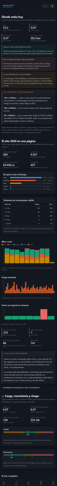
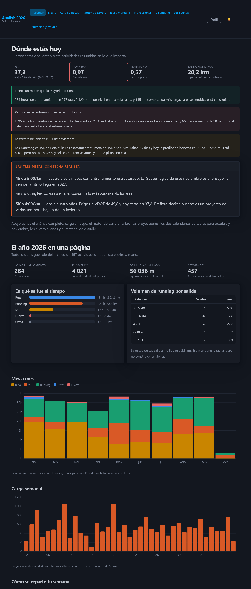
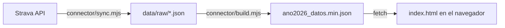
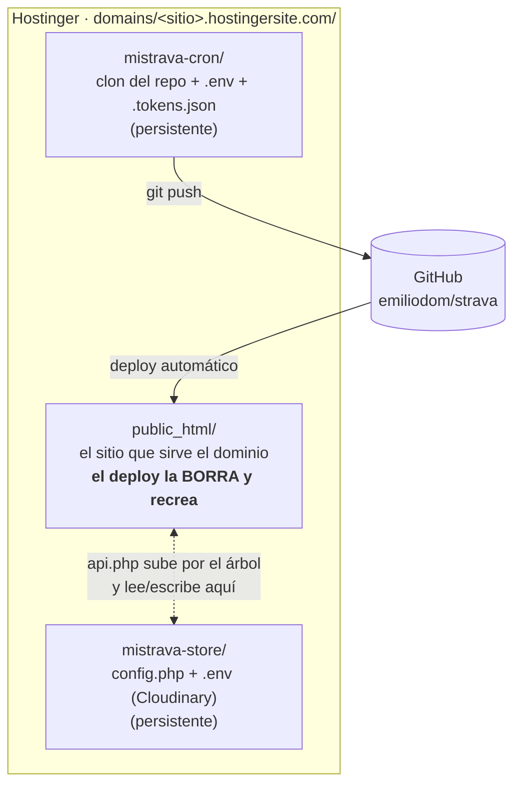
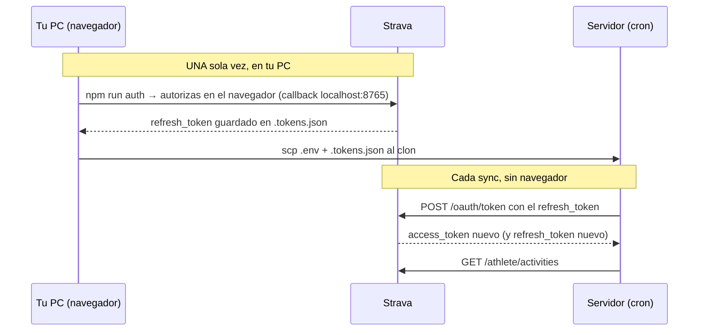
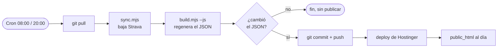

# Análisis 2026 · Emilio

Página de análisis de entrenamiento y planificación, alimentada por tus propios datos de Strava.
Todo el cálculo ocurre en el navegador; el conector sólo descarga y transforma.

## Capturas

<p align="center"> </p>



> **Versión 0.14.2** · ver [CHANGELOG.md](CHANGELOG.md) · comandos rápidos en [CHEATSHEET.md](CHEATSHEET.md)

## Los datos son públicos a propósito

`ano2026_datos.min.json` está en el repositorio como **ejemplo real** de un análisis de ciencia del deporte aplicado
a Strava: es el resultado de `connector/build.mjs` con las actividades de 2026 de su autor, y toda esa información
ya es visible en su perfil de Strava. Puedes abrir la página y verla funcionando sin configurar nada.

Para analizar **tus** datos, sigue los pasos de abajo: el conector genera tu propio JSON y lo sobrescribe.
Nunca se publican las credenciales (`connector/.env`, `.tokens.json`) ni el crudo de la API (`data/raw/`, que incluye trazados GPS).

## Qué mide

| Módulo | Contenido |
|---|---|
| Resumen y año | Totales, horas por deporte, hábitos, composición semanal y **«Lo que te toca hoy»** (la sesión del día con su detalle por deporte y comparación contra Strava) |
| Sesión del día | Desglose del **último día con datos** —o de **cualquier día del histórico** con el selector de fecha (◀ ▶ y lista desplegable)—, actividad por actividad: métricas por deporte, intensidad clasificada contra tus zonas (ritmo/FC), **ritmo y FC kilómetro a kilómetro** en las carreras, tiempo en cada zona de FC y veredicto contra el plan activo |
| Carga | Carga diaria, monotonía de Foster, ACWR (EWMA), recuperaciones |
| Running | VDOT de Daniels, ritmos de entrenamiento, metas, zonas por frecuencia cardiaca, eficiencia aeróbica y deriva |
| Bici | VAM, desnivel, MTB frente a ruta |
| Proyecciones | Corto, mediano y largo plazo |
| Calendario | **Tres caminos** (estructurado, intermedio y brutal) sobre las seis competencias, ahora con **entrenamiento híbrido** (bici + correr el mismo día): dobles AM/PM y bricks bici→carrera dosificados por nivel. Las actividades de Strava marcan automáticamente los días pasados y puntúan cada componente del plan por separado (carrera, bici, fuerza), además de mostrar un total global y los últimos 7 días frente al plan. Cada día abre el **detalle por deporte** y permite añadir notas o ajustar el registro. Cada día muestra **iconos** de lo que toca y, en los días pasados, un **anillo de cumplimiento**; hay tres diseños (cuadrícula, compacta, agenda) e interruptores para elegir qué datos ver. Exportable a `.ics` |
| Sueños | Maratón, 2.000 m D+, 150–200 km, mini Ironman |
| Cuerpo 360 | Escáner corporal: medidas, % de grasa estimado y rutas de composición (ver abajo) |
| Ciencia | Lactato, ultradistancia, combustible en carrera, suplementos y comidas favoritas |
| V-taper | Trabajo diario de dorsales y hombros (rutinas V/W/L de 5–14 min, sin cargar el pie), semana con casillas, medidas (cintura, pecho, hombros, brazo, peso), índice V = hombros ÷ cintura y copia JSON |
| Preparación | Qué hacer 15, 10 y 5 días antes de cada evento del calendario |
| Espalda y equilibrio | Dolor lumbar al subir, calambres y pérdida de equilibrio: causas, prevención, señales de alarma y dos rutinas (12 y 10 min) que también están en el calendario |
| Orden correr/bici | Botón en el calendario que voltea el orden propuesto en los días con correr y bici (bici primero si la bici es lo principal; correr primero en el resto) |
| Registro | Registro de comidas con foto hacia un endpoint PHP (ver abajo) |
| Recursos | Nutrición, recuperación y lecturas con enlaces verificados |

La FC sólo existe en las actividades donde el dispositivo la registró; la página indica la cobertura real.
Si conoces tu FC máxima, ponla en **Perfil**: las zonas se recalculan.

## Páginas, PDF y contraste

La página se organiza en siete **páginas** (Hoy · Calendario · Rendimiento · Metas · Cuerpo y ciencia · Comida · Registro); cada una agrupa módulos afines y tiene su URL (`#calendario`, `#rendimiento`…).

```bash
node connector/pdf.mjs [salida.pdf]   # informe completo en PDF (A4, tema claro, calendario apaisado)
node connector/contraste.mjs          # auditoría WCAG AA de texto y gráficos, claro y oscuro (código 1 si falla)
```

Ambos usan Chrome sin interfaz (variable `CHROME` si no está en la ruta habitual). El botón «PDF» de la cabecera hace lo mismo desde el navegador.
Al publicar una versión nueva, cambia `?v=…` de los `<script>`/`<link>` de `index.html` para que ningún navegador mezcle módulos viejos y nuevos.

## Pausa por lesión

`assets/ajuste.js` define `PAUSA` (`activa`, `desde`, `hasta`, `motivo`). Mientras esté activa, los días desde `desde` llevan `d.pausa = 1`: la portada y el calendario se ven en gris, no exigen nada, no cuentan para la carga proyectada y la comida va sin déficit. **No se borra nada del plan**: para reanudar basta `activa: false` (o fijar `hasta`). Tras la pausa del 21 oct, `RETORNO` (22 oct–4 nov) sobrescribe esos días en los tres planes: bici como base, racha caminando, pesas sin cargar el pie (rutina U) y boxeo sin desplazamiento (rutina G).

## Versionado

[SemVer](https://semver.org/lang/es/) con una etiqueta `vX.Y.Z` por hito. Mientras sea `0.x`, el esquema del JSON
puede cambiar entre versiones menores; el `CHANGELOG.md` lo indica.

## Puesta en marcha (una sola vez)

Necesitas **Node 20 o superior**. No hay dependencias que instalar.

### 1. Crear tu aplicación de Strava

En <https://www.strava.com/settings/api> crea "My API Application":

| Campo | Valor |
|---|---|
| Category | Data Importer |
| Website | `http://localhost:8000` |
| **Authorization Callback Domain** | **`localhost`** (exactamente eso, sin `http://` ni puerto) |

Apunta el **Client ID** y el **Client Secret**.

### 2. Configurar el conector

```bash
cp connector/.env.example connector/.env
# edita connector/.env y pega STRAVA_CLIENT_ID y STRAVA_CLIENT_SECRET
```

`connector/.env` y `connector/.tokens.json` están en `.gitignore`. **No los subas a ningún sitio.**

### 3. Autorizar

```bash
node connector/auth.mjs
```

Se abre el navegador, aceptas y la terminal confirma la conexión. Concede **"Ver todas tus actividades,
incluidas las privadas"**: sin ese permiso faltarán entrenamientos.

### 4. Descargar y generar

```bash
node connector/sync.mjs          # descarga incremental (la 1.ª vez tarda; después, segundos)
node connector/build.mjs --js    # genera ano2026_datos.min.json, datos.js y ano2026_datos.json (copia indentada, sólo local)
```

### 5. Ver la página

```bash
node connector/serve.mjs
```

Imprime una dirección `http://localhost:8000` y otra de tu red local para abrirla **en el móvil**
(la página está diseñada para pantalla pequeña primero).

Si prefieres abrir `index.html` con doble clic, funciona siempre que hayas generado `datos.js`
con `build.mjs --js`: el navegador bloquea `fetch` sobre `file://`, y `datos.js` esquiva esa limitación.

**V-taper: dónde se guardan lo hecho y las medidas.** La página (módulo V-taper) lo guarda en un archivo, además de en el navegador:
con `serve.mjs`, en `data/vtaper.json` (se versiona: haz commit); en el servidor PHP, en `mistrava-store/datos/vtaper.json`
(sobrevive a los deploys; hace falta poner el token en la página Registro). Sin ninguna de las dos, queda sólo en el navegador y
se usa «Exportar copia». Al abrir el módulo se lee el archivo y se reconcilia con el navegador (gana lo más reciente, o la unión
si el navegador no tenía marca de tiempo). Ojo: `data/vtaper.json` es público en la web desplegada.

## Uso diario

```bash
node connector/sync.mjs && node connector/build.mjs --js
```

o, desde `connector/`, `npm run actualizar`.

## Publicar en Google Cloud Storage

```bash
# una sola vez
gcloud auth login
gcloud config set project TU-PROYECTO
gcloud storage buckets create gs://TU-BUCKET --location=us-central1 --uniform-bucket-level-access
gcloud storage buckets add-iam-policy-binding gs://TU-BUCKET --member=allUsers --role=roles/storage.objectViewer
gcloud storage buckets update gs://TU-BUCKET --web-main-page-suffix=index.html --web-error-page=index.html

# y luego, cada vez
# (pon GCS_BUCKET=TU-BUCKET en connector/.env)
node connector/deploy.mjs --simular   # enseña los comandos sin ejecutarlos
node connector/deploy.mjs
```

Sube sólo `index.html`, `ano2026_datos.min.json` y `assets/`. Nunca `.env`, `.tokens.json` ni `data/raw/`.

> **Ojo con publicarlo**: el bucket queda accesible para cualquiera que tenga el enlace. Son tus datos de
> entrenamiento, con fechas y lugares. Si no quieres eso, quédate con `serve.mjs` en tu red local.

## Despliegue en Hostinger (producción con cron)

El sitio se publica en un hosting compartido de Hostinger conectado a GitHub: cada `push` a `main`
**borra y recrea todo `public_html`** con el contenido del repo. Eso obliga a separar tres cosas, porque
lo que se escribe en el servidor no puede vivir dentro de `public_html` (se borraría en cada publicación).

### Topología: qué vive dónde

Todo cuelga de `~/domains/<tu-sitio>.hostingersite.com/`:



- **`public_html/`** — sólo lo que el navegador descarga. `ano2026_datos.min.json` está versionado en el
  repo, así que llega aquí con cada deploy (queda junto a `index.html` y el `fetch` relativo lo encuentra).
  Que el wipe lo borre da igual: el deploy lo repone al instante.
- **`mistrava-store/`** (hermana de `public_html`) — el token (`config.php`) y, opcionalmente, las claves de
  Cloudinary (`.env`, ver `registro/store.env.example`). `registro/api.php` sube por el árbol hasta encontrar
  `public_html` y usa esta carpeta hermana, así que sobrevive a los deploys. Con Cloudinary las fotos del
  registro se guardan en su CDN (el navegador las pide directo por URL, sin pasar por el servidor); sin
  Cloudinary caen en `mistrava-store/datos/` como hasta ahora.
- **`mistrava-cron/`** (hermana de `public_html`) — un clon del repo que hace de "fábrica": aquí viven los
  secretos de Strava (`.env`, `.tokens.json`) y desde aquí corre el cron. **El dominio nunca mira esta
  carpeta**; sólo empuja datos a GitHub.

### Autenticación con Strava sin navegador (headless)

OAuth tiene un paso interactivo (navegador) y uno automático (sólo HTTP). El servidor sólo necesita el
automático:



El `refresh_token` de Strava no caduca mientras no revoques el acceso, y `sync.mjs` nunca toca `localhost`:
por eso el servidor no necesita navegador. Como Strava devuelve un `refresh_token` nuevo en cada refresco y
el connector lo reescribe, el `.tokens.json` **debe** vivir en el clon persistente (no en `public_html`).

### El ciclo del cron



El script es [`connector/actualizar.sh`](connector/actualizar.sh). La primera corrida tarda ~40-45 min
(baja el detalle de todas las carreras, con el límite de 100 peticiones/15 min de Strava); las siguientes
son incrementales y tardan segundos.

> **Los pasos exactos de montaje y los comandos están en [CHEATSHEET.md](CHEATSHEET.md).**

## Exportar el calendario a Google Calendar

Dentro del módulo **Calendario** tienes dos salidas, para el camino que tengas activo (estructurado, intermedio o brutal):

- **Descargar .ics** — el archivo que importas en Google Calendar (*Configuración → Importar y exportar*),
  en Apple Calendar o en Outlook. Crea los 57 días como eventos de todo el día.
- **Añadir a Google Calendar** — un enlace por día, por si sólo quieres meter las carreras.

## Calendario y seguimiento frente al plan (Strava)

El calendario analiza continuamente el cumplimiento de tu entrenamiento cruzando lo programado con lo registrado en Strava:

- **Tres caminos personalizables**: Estructurado, Intermedio y Brutal, ajustados a tus competencias y con soporte de **entrenamiento híbrido** (carrera + bici el mismo día, dobles AM/PM y bricks).
- **Cruce automático con Strava**: Los días pasados detectan automáticamente tus actividades registradas en Strava (carrera, ciclismo, fuerza u otros entrenamientos) sin necesidad de captura manual. Si añades notas o ajustas un día manualmente, tu registro prevalece sobre los valores automáticos.
- **Puntuación rigurosa por componente**:
  - Cada sesión planificada se descompone en sus disciplinas previstas: carrera (km), ciclismo (minutos) y fuerza (rutinas A/B/C).
  - Cada componente exige un umbral mínimo de volumen (≥80% de la distancia o tiempo previsto; mínimo 15 minutos en fuerza) para considerarse cumplido (`✓`).
  - Actividades incompletas o de duración residual (por ejemplo, 1–3 minutos de rodaje suave o transferencias breves) se clasifican como parciales (`≈`) y no inflan el puntaje de cumplimiento.
  - La ausencia de actividad en el deporte programado se clasifica como no realizada (`✗`).
  - Los deportes distintos no se intercambian: una actividad de bici no convalida una sesión de fuerza o carrera.
- **Insignias y estado visual diario**: Cada celda del calendario muestra una insignia compacta con el recuento de componentes cumplidos frente a los previstos (`cumplidas/previstas`, ej. `2/2` o `1/2`), con bordes codificados por color (verde para día completo, ámbar para parcial, rojo para día no realizado).
- **Balance rodante de los últimos 7 días**: Una tarjeta resumen compara los km de carrera y minutos de bici acumulados en la última semana frente al plan activo, calculando una **puntuación global** (`X/Y cumplidas` y porcentaje de adherencia real).
- **Consistencia en carga y descanso**: Los días de descanso o eventos en bicicleta con distancias nominales no distorsionan el volumen de carrera planificado ni inflan falsamente la carga proyectada (ACWR).

## Reorganizar el plan cuando no se hizo una sesión

En el hero de la portada y en el detalle de cada día del calendario hay un botón **«No la hice · reorganizar»**. Al usarlo, `assets/replan.js` reacomoda los días siguientes con reglas fijas (sin IA, sin red):

1. Las competencias y los descansos no se reprograman.
2. Si Strava ya trae algo ese día, sólo se reprograma lo que faltó (plan − real).
3. **Sesión dura** (Q, H, S, T, F, V, M, L): pasa entera al primer día suave (E/R/D) de los próximos 4 que no deje dos días duros seguidos y no caiga a ≤2 días de una competencia A/B (≤1 de cualquier otra). Sin hueco seguro, baja a volumen fácil al 70 %.
4. **Volumen fácil** (km de carrera y minutos de bici): se reparte en los próximos 4 días con tope de +25 % por día (máx. +2 km, +20 min). Lo que no cabe se descarta; no se «cobra» el atraso de golpe.
5. **Fuerza**: pasa al primer día suave sin fuerza; si no hay, se descarta.

Todo queda en una bitácora (modal «Plan reorganizado» en el hero y panel en el calendario) y se puede deshacer día por día o con «Restablecer plan original». Los días saltados se guardan sólo en el navegador (`calSaltos`). `App.calExport.dias(plan)` ya devuelve el plan reorganizado, así que todos los módulos lo usan.

## Diseño

Móvil primero, sin dependencias nuevas (ni fuentes ni librerías de UI): todo vive en `assets/app.css` sobre Pico.

**Paleta (psicología del color para apps de ejercicio)**

| Rol | Claro | Oscuro | Por qué |
|---|---|---|---|
| Acento primario (naranja) | `#e0541b` | `#ff6a2b` | Energía, acción y motivación: botones, pestaña activa, barras. |
| Base | `#faf7f3` cálido | `#0b1120` azul marino | El azul profundo transmite enfoque y calma; el fondo cálido cansa menos la vista. |
| Ok / recuperación | `#0f9f78` | `#2dd4a3` | Verde-turquesa: recuperado, cumplido. |
| Precaución | `#d98a00` | `#fbb73a` | Ámbar: a medias, vigilar. |
| Riesgo | `#d93a3a` | `#ff6b6b` | Rojo sólo para alertas reales. |

Los tokens están al final de `app.css` (`:root` y `[data-theme=dark]`); cambiar el tema entero es editar esas variables. Los colores de Pico (`--pico-*`) se sobrescriben ahí mismo.

**Tipografía**: pila de sistema (`Inter` si está instalada), títulos de peso 800–900 con interletrado cerrado y cifras tabulares para que las métricas no «bailen». El título del hero usa `clamp()` para escalar con la pantalla.

**Portada**
- **Hero**: la sesión de hoy en grande (tipo, distancia/minutos, objetivo), botón «Ver sesión», cuenta atrás a la Guatemágica y la tira de la semana. El brillo pasa a ámbar en días tipo `C`. Se pinta en `resumen.js` (clases `.hero*`).
- **Slider**: bajo 700 px las fichas son una fila deslizable con *scroll-snap* y puntos de posición (`#slider`, `#dots`); desde 700 px vuelven a ser una cuadrícula. Los puntos se sincronizan en `montar()` de `resumen.js`.
- Las fichas «Hoy» y «Esta semana» ya no existen como fichas: sus modales se abren desde el hero (`data-modal='hoy'` / `'semana'`).
- Se respeta `prefers-reduced-motion`.

## Estructura

| Ruta | Qué es |
|---|---|
| `index.html` | El armazón: carga los estilos y los módulos. |
| `index.original.html` | La versión estática original, guardada por si acaso. |
| `assets/pico.css` | Pico.css, el framework de base. |
| `assets/app.css` | La capa propia, móvil primero: tokens de color, tipografía, hero y slider (ver «Diseño»). |
| `assets/core.js` | Formato de números, fechas y estadística. |
| `assets/charts.js` | Gráficas en SVG, sin librerías. |
| `assets/metrics.js` | El motor: carga, ACWR, monotonía, VDOT, zonas. |
| `assets/plan.js` | Los tres planes, los tipos de sesión, las rutinas de fuerza, de prevención y las carreras. |
| `assets/actividad.js` | El detalle de cada actividad por deporte (ritmo e intensidad objetivo), reutilizado en el calendario y en «Lo que te toca hoy». |
| `assets/modules/*.js` | Un archivo por módulo de la página. |
| `connector/` | OAuth, descarga, transformación, servidor y despliegue. |
| `connector/actualizar.sh` | Tarea de cron del servidor: `git pull` → sync → build → `git push` del JSON. |
| `registro/api.php` | Endpoint del registro de comidas (acciones `lista`, `foto`, `subir`, `borrar`) y del V-taper (`vt_leer`, `vt_guardar`); guarda token, fotos y `vtaper.json` en `mistrava-store/` (fuera de public_html). |
| `CHEATSHEET.md` | Comandos rápidos: uso diario, montaje del servidor y cron. |
| `data/raw/` | El crudo de la API. No se versiona: se regenera. |

## Si algo falla

| Síntoma | Causa |
|---|---|
| `Faltan STRAVA_CLIENT_ID…` | No creaste `connector/.env` a partir del ejemplo. |
| Strava devuelve `redirect_uri` inválido | El *Callback Domain* de tu app no es exactamente `localhost`. |
| `No hay sesión de Strava` | Ejecuta `node connector/auth.mjs` antes que `sync.mjs`. |
| La página dice que no encuentra los datos | Abriste `index.html` con doble clic sin generar `datos.js`. Usa `build.mjs --js` o `serve.mjs`. |
| Sin VDOT ni mejores esfuerzos | Sincronizaste con `--sin-detalle`. Los 1k/5k vienen del detalle de cada carrera. |
| `límite de la API alcanzado` | Strava permite 100 peticiones cada 15 min. El conector espera solo; déjalo correr. |

## Datos inconsistentes

`build.mjs` marca y excluye de las estadísticas las actividades con datos imposibles (entradas manuales
duplicadas, tiempos corruptos, ritmos de GPS disparatado) y las lista al terminar. Si no estás de acuerdo
con alguna, crea `connector/anomalias.json`:

```json
{ "14321234567": "motivo por el que la excluyo", "14399999999": null }
```

`null` rehabilita una actividad que el detector marcó por error.

## Cuerpo 360 (experimental)

Escáner corporal: pon las fotos y un `measurements.txt` (`waist=37in`, `weight=77kg`, `height=1.70mts`, `age`, `gender`…) en `data/body360/<atleta>/<fecha>/`, añade las cajas de cara en `connector/caras.json` y ejecuta `python connector/body360.py` (sólo Pillow). El script difumina la cara (pixelado + desenfoque), borra EXIF/GPS y genera `body360.js`; el módulo calcula IMC, cintura/talla, % de grasa estimado (CUN-BAE y Deurenberg) y dos rutas (normal y brutal), con nutrición guatemalteca, sueño, estrés y fuerza. Los originales (con cara) están en `.gitignore`; sólo se publican las copias difuminadas y las medidas, por decisión del autor.

## Registro de comidas (PHP)

Copia `registro/config.example.php` como `config.php` dentro de `mistrava-store/` (no se versiona) y pon un token largo; el mismo token se escribe una vez en el módulo Registro. Para que las fotos vayan a Cloudinary (recomendado: quita límites de disco, sirve por CDN y descarga al servidor de guardarlas), copia `registro/store.env.example` como `.env` en esa misma carpeta con tu `CLOUDINARY_CLOUD_NAME`, `CLOUDINARY_API_KEY` y `CLOUDINARY_API_SECRET`; sin ese `.env` las fotos se guardan en disco como antes. Para evaluar la semana en local agrega `COMIDAS_URL` y `COMIDAS_TOKEN` a `connector/.env` y ejecuta `node connector/comidas.mjs`: crea `data/comidas/resumen-<fecha>.md` con las fotos (las baja del CDN si están en Cloudinary), listo para pasárselo a la IA.

## Licencia

[MIT](LICENSE) © 2026 Emilio Dominguez. Los datos de ejemplo son del propio autor; el logotipo de Strava no se redistribuye.
